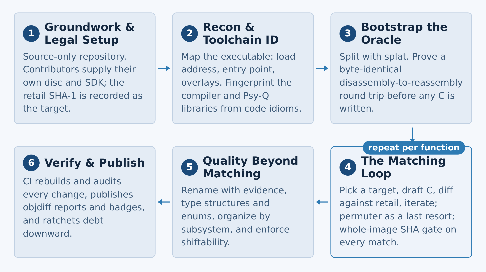

# The Workflow

Six phases, synthesised from four matching PSX decompilation projects
([tenchu-decomp], [lsddecomp], [parasite-eve-decomp], [rage-racer-decomp]).
The numbering is chronological, but only phase 3 is a true loop — everything
else is traversed once per project (and re-run per binary or per region where
a game has several targets).

The goal that shapes all of it is a **matching decompilation**: C source
that, compiled with the original toolchain, reproduces the retail executable
byte for byte. A paraphrase of a program can be subtly wrong without anyone
noticing; a byte-exact rebuild cannot. That single target settles every
debate downstream.

## Phase 0 — Groundwork and legal setup

Decide what the repository will and will not contain, and the answer is
identical in all four projects: **source only**. No disc images, no extracted
assets, no FMV, no Sony Psy-Q SDK files, no compiler binaries, and no retail
executables are ever committed. Contributors supply legally obtained copies,
and the build reads them from git-ignored directories (`disk/`, `sdk/`,
`baselines/`, `assets/`). This posture is what keeps the project publishable:
CI must be able to clone and audit the tree without ever touching copyrighted
material. (LSD reads its private dependencies from a separate private
repository at CI time, so the public pipeline still runs end to end.)

This template ships that policy already wired: `.gitignore`, the pre-commit
hook, and the `LICENSE` scope note. Record your target revision's executable
name, SHA-1 and entry point in the README as the definition of success —
every address in every config is valid for exactly one revision.

## Phase 1 — Reconnaissance and toolchain identification

Turn a retail disc into a fully characterised build target. Map the memory
layout first, because it drives the entire build architecture: a single plain
executable (LSD) splits and rebuilds trivially; a resident executable plus
overlays loaded into fixed RAM windows (Parasite Eve, 162 room overlays and
22 scene sets) needs per-overlay manifests and checks.

Then identify the **exact** toolchain, because PSX compilers left
fingerprints:

| Project | Compiler | Notes |
| --- | --- | --- |
| lsddecomp | Psy-Q GCC 2.6.3 | maspsx, binutils, splat, pinned |
| parasite-eve-decomp | GCC 2.7.2 cc1 | maspsx, Psy-Q 4.0, binutils |
| tenchu-decomp | GCC 2.8.1 cc1 | maspsx, GNU ld, nix-pinned, Shake driver |
| rage-racer-decomp | Old PSX GCC variants | maspsx, binutils |

Never a modern compiler; never an unpinned one. [maspsx] reproduces Sony's
ASPSX assembler macro expansion for GNU `as`; [splat] splits the executable.
Where luck provides extra evidence, mine it systematically: Tenchu recovered
original file names, prototypes and struct layouts from a demo disc's
`PSX.SYM`, then audited its own declarations against those records before
trusting them. The phase ends with a written statement of facts (flags, load
address, `$gp`, SDK object list) that later phases treat as fixed.

## Phase 2 — Bootstrap the byte-exact oracle

Before anyone writes a line of C, prove the project can rebuild the game
from its own disassembly. `splat` splits the executable into per-function
assembly, data, a linker script and symbol lists; the pinned toolchain
reassembles everything; the build asserts the result is **byte-identical to
retail**. LSD's setup script refuses to finish unless the first build already
matches. Tenchu's docs call this round trip the foundation of the whole
project.

Only against this green base does C work begin, and it proceeds one function
at a time, so any regression is attributable to exactly one change. Phase 2
also installs the verification gate the rest of the project lives inside —
here, `make verify`, the single build entrance, ending in
`OK: build matches retail ...`. See `docs/RULES.md` §1 for why nothing may
bypass it.

## Phase 3 — The matching loop

The heart of the project and the only phase that repeats thousands of times.
Selection is a tool job, not a taste job: pick small, clean-seam functions
first; map a new subsystem's shared structs once so whole families become
cheap; prefer functions with already-matched twins. The draft is seeded
mechanically (Ghidra + [m2c]), then shaped by hand against the compiler's
known idioms, iterating **length-first** — see `docs/MATCHING.md` for the
full ladder, the ways a score lies, and the honest NON_MATCHING parking
policy.

The loop closes with the only acceptance test that matters: the whole-image
checksum. A per-function diff may say MATCH, but only the linked image
promotes the result.

## Phase 4 — Quality beyond matching

Matching is one quality level, not the finish line. **Matched ≠ finished.**
A file is finished when it is byte-matched *and* fully named, typed, free of
hidden fixed addresses, and placed in its subsystem. This phase is deliberate
cleanup: replace `func_`/`D_` placeholders with evidence-backed names,
convert raw offsets into typed struct fields, define data tables as C, and
drive readability debt (magic numbers, raw offsets, unknown fields) toward
zero under the ratchets. Organisation gets the same evidentiary care as the
bytes — translation-unit boundaries follow the evidence order in
`docs/GUIDELINES.md` §2, never aesthetics.

## Phase 5 — Continuous verification and publishing

Keep the project honest for years. CI on every push rebuilds, checks the
retail hash, and publishes an [objdiff] report that [decomp.dev] renders as
per-function progress. Ratchets make regressions impossible to hide: debt
and placeholder counts go down or hold, never up, and raising a baseline is
a reviewed policy change. Badges are regenerated from measured data, not
typed in — a hand-written number goes stale within a round. This template's
`.github/workflows/ci.yml` has the skeleton of all three jobs.

[tenchu-decomp]: https://github.com/Fuuzetsu/tenchu-decomp
[lsddecomp]: https://github.com/brian-oblivion/lsddecomp
[parasite-eve-decomp]: https://github.com/khasinski/parasite-eve-decomp
[rage-racer-decomp]: https://github.com/khasinski/rage-racer-decomp
[splat]: https://github.com/ethteck/splat
[maspsx]: https://github.com/mkst/maspsx
[m2c]: https://github.com/matt-kempster/m2c
[objdiff]: https://github.com/encounter/objdiff
[decomp.dev]: https://decomp.dev
