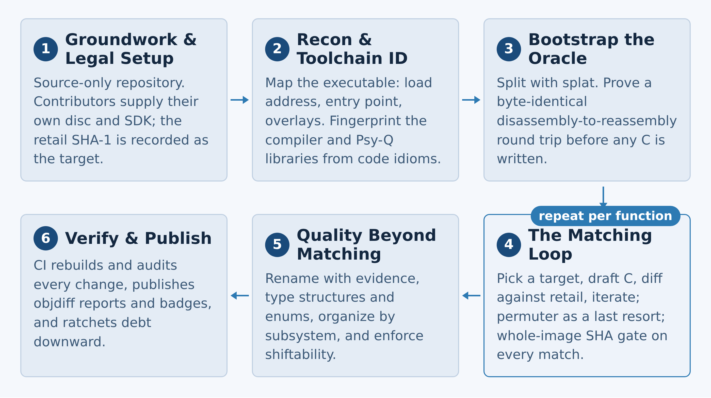

# The workflow

This workflow summarizes steps from four reference projects ([tenchu-decomp], [lsddecomp], [parasite-eve-decomp], [rage-racer-decomp]). Phase 3 runs as a loop. Other phases run once per project or once per target binary.

The project goal is a **matching decompilation**: C source that compiles with the original toolchain to reproduce the retail executable byte for byte.

## Phase 0: Groundwork and legal setup

The project's intended publishing policy is source-only: do not add disc images, extracted assets, FMV video, Sony Psy-Q SDK files, compiler binaries, or retail executables. Contributors supply their own legal retail copies; build tools normally read them from git-ignored directories (`disk/`, `sdk/`, `baselines/`, `assets/`). **Historical exception still pending separate remediation:** legacy retail executables are tracked under `extract/jp/` and `extract/eu/`. Do not add more; the owner has deferred any destructive history rewrite. See [STATUS.md](STATUS.md).

This repository includes `.gitignore`, pre-commit hooks, and license documentation. Record the target executable name, entry point, and SHA-1 in the README.

## Phase 1: Reconnaissance and toolchain identification

Examine the retail executable to determine the memory layout and toolchain:

| Project | Compiler | Notes |
| --- | --- | --- |
| lsddecomp | Psy-Q GCC 2.6.3 | maspsx, binutils, splat |
| parasite-eve-decomp | GCC 2.7.2 cc1 | maspsx, Psy-Q 4.0, binutils |
| tenchu-decomp | GCC 2.8.1 cc1 | maspsx, GNU ld, pinned, Shake driver |
| rage-racer-decomp | Old PSX GCC variants | maspsx, binutils |

Use pinned historical compilers. [maspsx] translates Sony ASPSX macros for GNU `as`. [splat] splits the target executable. Extract debug symbols and header details from demo discs to recover names and prototypes. Phase 1 ends with documented build flags, memory layouts, `$gp` values, and library object lists.

## Phase 2: Bootstrap the byte-exact oracle

Prove the disassembly round trip before you write C code. `splat` splits the binary into per-function assembly, data sections, linker scripts, and symbol maps. Reassemble the split files with the pinned toolchain. Verify that the output matches the retail binary byte for byte.

Once the disassembly matches, start decompilation one function at a time. Phase 2 installs `make verify` as the primary build entrance.

## Phase 3: The matching loop

Repeat this phase for every target function. Start with short, self-contained functions. Map shared structures early. Reference matched sibling functions to find compiler idioms. Draft C source with Ghidra and [m2c]. Match code length first. Refer to `docs/MATCHING.md` for iteration steps and parking policies.

The loop ends when `make verify` succeeds.

## Phase 4: Quality beyond matching

A function is finished when it matches byte for byte, uses clear names, uses typed structures, avoids raw numeric addresses, and resides in its subsystem. Replace `func_` and `D_` placeholders with verified names. Map raw offsets to structured types. Track remaining debt with ratchets. Base file boundaries on structural evidence (`docs/GUIDELINES.md` §2).

## Phase 5: Continuous verification and publishing

Automate checks to protect code quality:

* **Current:** GitHub Actions runs Python unit tests, syntax checks, debt ratchets, and a heuristic progress report on commits and PRs. It **does not** build retail executables or check their SHA-1 (see [CI.md](CI.md)).
* **Current:** Actual byte equivalence remains the separately provisioned, witnessed eight-target `make verify` process, gated on the attested toolchain.
* **Future goal, not implemented CI:** reproducible full-oracle verification on an authorized runner and automated visual diffs such as [objdiff]/[decomp.dev].
* **Current:** Ratchets prevent placeholder-debt regressions; they are not a direct progress measure of semantic C recovery.
